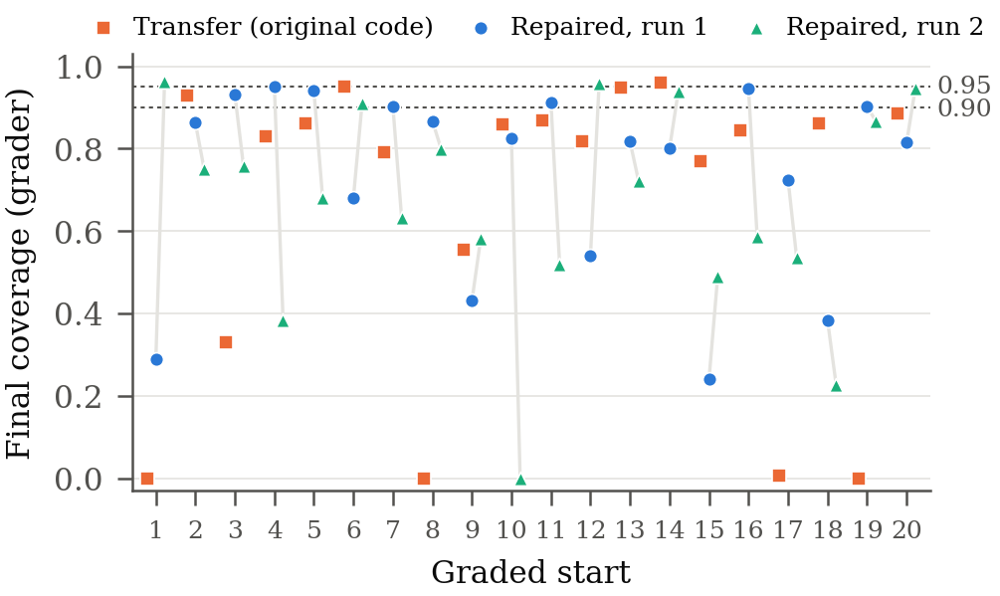

# Push-T on a real SO-101 arm

A recent paper ([Xie, Chen and Goldberg](https://arxiv.org/abs/2608.18227)) had Claude Code write Push-T controllers from one-sentence prompts, and they got near-perfect results in simulation. I wanted to know what happens on a real arm. So I gave the same prompts to a new run of the same agent and ran its code on my SO-101, with a webcam looking down, a T I printed at half the gym's size, and a separate camera grader so the controller can't grade itself.

Short version: 20/20 in the gym, 2/20 on the real arm.

Paper: arXiv link coming soon.



*Each dot is one run. Orange is the original code, blue and green are the repaired code run twice. Same starts every time.*

## How it went

| Batch | Mean coverage | Hit 0.95 | Hit 0.90 |
|---|---|---|---|
| Gym (simulation) | 0.957 | 20/20 | 20/20 |
| Real arm, original code | 0.654 | 2/20 | 4/20 |
| Real arm, repaired code | 0.738 | 1/20 | 7/20 |
| Same repaired code again, next evening | 0.662 | 2/20 | 5/20 |

1. **Gym.** The agent wrote the controller overnight in simulation (2 h 48 m, nobody touching it). It passed all 20 of my starts.
2. **Real arm.** Same code, same 20 starts: 2 passed. Most runs still got close (median 0.84), but a few blew up. In 3 of them it pushed the T out of the arm's reach and never got it back.
3. **Repair.** I gave the agent the paper's second prompt and let it practice on 10 other starts I never graded. It used 29 of its 40 practice runs, then said it was done. It went up by 0.084, but that's not distinguishable from zero (p = 0.37).
4. **Same code again.** I ran the exact same repaired code the next night. It scored 0.662, and the two runs were basically uncorrelated start by start (r = 0.02). Start 10 went from 0.824 to 0.001 with no code change. So with one run per start, I honestly can't tell if the repair helped.

## What the agent built during repair

It didn't build the calibration and friction-fitting stuff the original paper describes. Instead it:
- refits the camera to the desk dots every time it looks
- stops a push if the T drifts more than 9 mm or 12° from what its sim predicted
- switches between modes (normal, small pushes, recovery, turning, endgame) when pushes keep missing
- added a few hand-tuned numbers from practice

It also noticed my camera had drifted about 3 mm (the mount is a selfie stick taped to a wall, so yeah) and worked around it before I even found it.

At one point it made the controller import my grader to check its own score. That wasn't allowed but my prompt didn't say so, so that was on me. I told it the rule and it took it out. The final code doesn't touch the grader.

## Check my numbers

Both scripts only use the Python standard library, so no installs:

```bash
python analysis.py        # the batch table, paired tests and noise
python run_variation.py   # what good runs have in common (spoiler: nothing except how close the run got)
```

## Stuff that didn't go great

- The 0.95 rule only allows about 1 mm of slide, and my arm's backlash is about 2.2 mm, so 0.95 is basically luck on this arm
- Lighting wasn't the same between the two repaired runs (second night was 26% darker), and I don't know if that's why they differ
- I planned a surface test and a camera bump test but didn't run them. My rules said to skip the camera test if the noise was too high, and it was.
- One arm, one T, one run per start. Take it as one rig, not a general result.

## Files

| File | What it is |
|---|---|
| `experiment/RULES.md` | My rules, guesses and gates, written before the graded runs, plus everything that went wrong |
| `experiment/prompts.md`, `experiment/repair_prompt.md` | The exact prompts |
| `experiment/starts.csv` | The 20 graded starts and 10 practice starts |
| `experiment/gym_agent/` | The controller the agent wrote in simulation |
| `repaired/` | The controller after the agent's repair |
| `transfer_run.py`, `experiment/desk_gym.py` | Runs the controller on the real arm |
| `grader.py`, `score_run.py`, `coverage_score.py` | The separate camera grader |
| `runs/scores.jsonl` | Every run's score |
| `runs/transfer_*.json` | Every push of every run |
| `analysis.py`, `run_variation.py` | The analysis behind every number |

Camera frames and videos are about 20 GB, so they're not in here.

Both controllers were written by the agent being tested. The rest was built with help from Claude Code.
